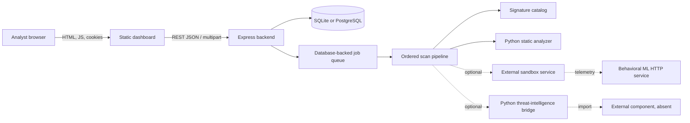
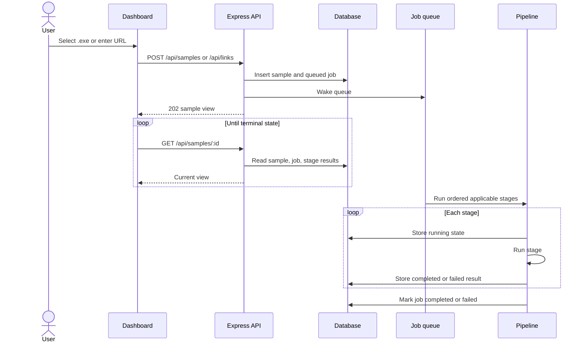

# Sentinel Architecture

## Purpose

This document describes the architecture implemented or represented in `dev-branch` on 2026-11-03. Solid paths in the diagrams are available in this repository; dashed or explicitly optional paths require configuration or components that are absent from the branch.

## System context

Text alternative: the browser talks only to the Express backend. The backend serves the static site, persists users/scans/jobs/results, and runs an ordered pipeline. Signature lookup and a static-analyzer subprocess are the default stages. Sandbox, behavioral ML, and threat-intelligence stages are configuration-gated. The sandbox and external threat-intelligence component are not included in this branch.

## Component boundaries

| Boundary | Producer | Consumer | Current contract |
| --- | --- | --- | --- |
| Browser API | `website/` | `backend/src/routes/` | JSON plus multipart upload; [API contract](../backend/docs/api-contract.md) |
| Persistence | Backend stores/routes/queue | SQLite or PostgreSQL adapter | Shared logical tables through `backend/src/db.js` |
| Static analyzer | `malware_detection/analyze.py` or mock | `runAnalyzer.js` | One JSON object on stdout; schema 1.0.0–1.2.0 accepted |
| Sandbox | External `/detonate` service | `sandboxClient.js` | Multipart file and timeout; JSON telemetry response |
| Sandbox-to-ML | Sandbox report | `sandboxToMl.js`, then ML HTTP service | Validated normalized JSON report |
| Behavioral inference | `ML/predict.py --serve` | Backend HTTP stage | POST JSON; JSON score/evidence response |
| Threat intelligence | Pipeline report adapter | Python bridge and external component | JSON stdin/stdout; provider/model contract unavailable |

## Scan lifecycle

The API normally returns `202 Accepted` immediately. `?wait=true` holds the request until completion or the configured wait timeout and returns `201` only when the job finishes in time.

## Pipeline ordering and gates

Actual order is defined in `backend/src/pipeline/stages.js`.

| Order | Stored stage name | Applies to | Enablement | Current implementation |
| --- | --- | --- | --- | --- |
| 1 | `signature` | File, link | Always | Checks local SHA-256 or URL/domain catalog. |
| 2 | `static_analysis` | File | Always | Runs mock by default or real analyzer by configuration. |
| — | `static_ml` | Intended for files | Not registered | Planned requirement; no current backend stage. |
| 3 | `sandbox` | File | `SANDBOX_URL` | Client and validation present; service absent. |
| 4 | `behavioral_ml` | File | Runs with sandbox | Adapter and HTTP client present; depends on usable sandbox telemetry. |
| 5 | `llm` | File, link | `LLM_DIR` | Adapter and bridge present; external component absent. |

A stage exception is stored as that stage's failure. Later stages are still considered, so one unavailable component does not delete earlier evidence. Dependency-aware stages fail clearly when their required earlier report is absent.

## Data and persistence

The backend uses one logical schema for SQLite and PostgreSQL. Tables cover users, sessions, samples, jobs, stage results, and threat-intelligence indicator results. Uploaded files remain on the receiving backend's filesystem; `worker_id` keeps a backend from processing another machine's job when the database is shared.

Important persistence properties:

- Passwords use scrypt hashes; raw passwords are not stored.
- Session cookies carry a random token; only its SHA-256 is stored.
- Scans belong to a signed-in user or to the guest scope.
- Jobs interrupted in `running` state are re-queued for their owning worker at startup.
- Stage reports are JSON and are returned to the dashboard without a unified cross-stage result schema.
- The repository does not define upload retention, record retention, or deletion endpoints.

See [backend database documentation](../backend/docs/azure-database.md) for the optional shared PostgreSQL configuration.

## Authentication and browser boundary

Registration and login are optional for local use. Successful registration also creates a session. The backend sets an HttpOnly `sentinel_session` cookie; `COOKIE_SECURE` must be enabled when HTTPS is used. Credentialed CORS is limited to configured development origins. Repeated failed logins are rate-limited per username and IP in the current process.

Serving `website/` from the backend is the simplest supported deployment because pages and APIs share an origin. A separately served frontend must use an allowed `CORS_ORIGINS` entry and send credentials.

## Failure behavior

- Request validation errors use JSON bodies with stable `error` codes.
- Upload size rejection returns `413`.
- Malformed catalog configuration stops startup instead of silently dropping entries.
- Analyzer timeout, nonzero exit, invalid JSON, unsupported schema, and launch failures are stored with stage-specific codes.
- Optional HTTP service timeouts, connection failures, non-2xx responses, and invalid JSON fail only their stage.
- Sandbox output with no usable telemetry is rejected rather than scored as zero activity.
- A job-level failure is separate from a stage failure; a scan can complete with one or more failed stages.

## Deployment shapes

### Default local demonstration

One Node process serves the site/API, uses local SQLite, executes the mock analyzer, and runs two default stages. This is the only zero-external-service path.

### Integrated development configuration

The Node process may use PostgreSQL, the real static analyzer, an external sandbox, the ML HTTP service, and an external threat-intelligence component. This shape is represented by adapters but cannot be completed from the contents of this branch alone.

### Not supported as production architecture

The current queue runs inside one backend process, uploads are local to the receiving host, sessions are cookie-based without a reverse-proxy deployment guide, and no production sandbox or observability stack is supplied. Horizontal multi-worker processing, artifact storage, deletion, audit logging, TLS termination, and secrets management require additional design.

## Security and safety boundaries

- The static analyzer parses files; it does not execute them.
- Real malware detonation is outside the verified capability of this branch.
- The backend stores uploads and can call external services; use inert inputs and nonproduction credentials.
- URL submission checks indicators but does not fetch the submitted URL itself.
- The LLM adapter filters private, loopback, and link-local IPs from enrichment, but that is not a complete privacy policy.
- A lack of signature, YARA, reputation, or behavioral evidence is not proof that a sample is benign.

## Related documentation

- [Setup and Operations](setup-and-operations.md)
- [Prototype Status](prototype-status.md)
- [Backend component](components/backend.md)
- [Static analyzer report contract](../malware_detection/REPORT_CONTRACT.md)
- [Backend API contract](../backend/docs/api-contract.md)
