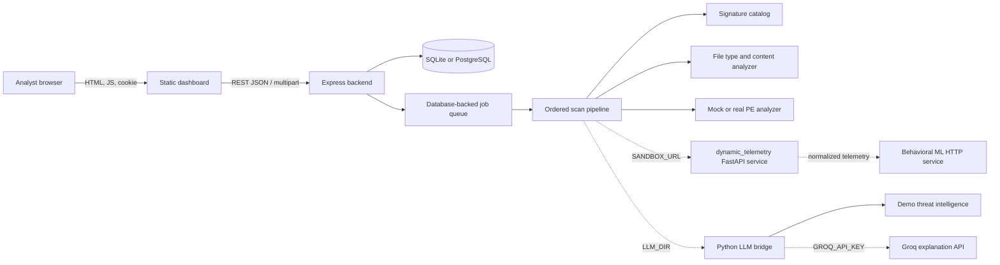
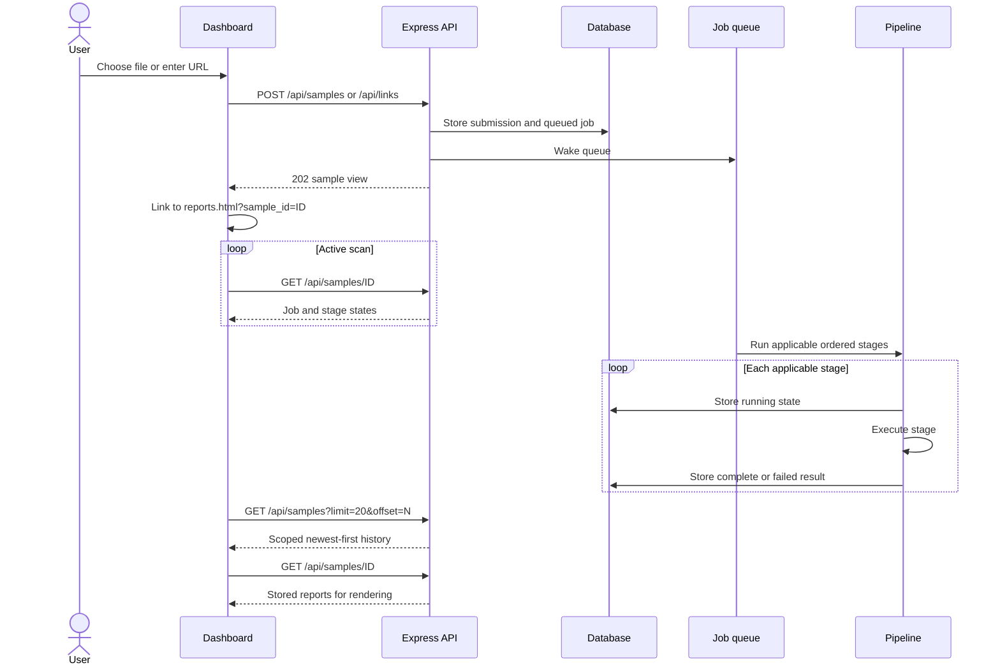

# Sentinel Architecture

## Purpose

This document describes `dev-branch` as implemented or represented on 2026-11-19. Solid paths in the diagrams are available in this repository. Optional paths require configuration, dependencies, or environment setup; source presence does not imply that a live external system or safety boundary was verified.

## System context

Text alternative: the browser communicates with the Express backend. The backend serves the site, persists users/scans/jobs/results, and runs ordered stages. Signature lookup, file identification, and conditional PE or content analysis are the default path. Sandbox plus behavioral ML and LLM/threat intelligence are configuration-gated. The dynamic and LLM component source is committed, but live sandbox operation, provider calls, and their security properties are not established by the default local run.

## Browser and scan lifecycle

The API normally returns `202 Accepted` immediately. `?wait=true` holds a submit request until completion or `WAIT_TIMEOUT_MS`, returning `201` only if the job finishes in time. The reports page uses `website/dashboard/reports.js` to load history, preserve selection in the URL, poll active scans, and stop polling at terminal state.

## Pipeline routing

Actual ordering and gates are defined in `backend/src/pipeline/stages.js`.

| Order | Stored stage | Applies to | Enablement and routing | Current implementation |
| --- | --- | --- | --- | --- |
| 1 | `signature` | File, link | Always | File SHA-256 or normalized URL/domain lookup in the local catalog. |
| 2 | `file_type` | File | Default; disabled with empty `CONTENT_ANALYZER_PATH` | Identifies bytes and reports category, format, extension mismatch, warnings, and risk summary. |
| 3a | `static_analysis` | File | PE/DOS, unknown category, or failed/disabled `file_type` | Mock PE report by default; real `malware_detection/analyze.py` by configuration. |
| 3b | `content_analysis` | File | Every detected non-PE format, including unknown | Bounded static evidence for Office, PDF, scripts, source, archives, shortcuts, web, and generic binaries. |
| — | `static_ml` | Intended file path | Not registered | FR03 remains planned/not present. |
| 4 | `sandbox` | File | `SANDBOX_URL` | Backend multipart client plus `dynamic_telemetry/api.py` service source; live environment unverified. |
| 5 | `behavioral_ml` | File | Added with sandbox | Maps usable sandbox output and calls `BEHAVIORAL_ML_URL`. |
| 6 | `llm` | File, link | `LLM_DIR` | Demo indicator lookup, evidence prompt, and optional Groq explanation. |

Stages with `shouldRun()` that do not apply create no result row. A stage exception is stored as that stage's failure, and later stages are still considered. Dependency-aware stages fail explicitly when required earlier output is absent or unusable.

## Component boundaries

| Boundary | Producer | Consumer | Contract and status |
| --- | --- | --- | --- |
| Browser API | `website/` | `backend/src/routes/` | Multipart/JSON plus cookie auth; [API contract](../backend/docs/api-contract.md). |
| Persistence | Backend stores/routes/queue | SQLite or PostgreSQL adapter | Shared logical schema in `backend/src/db.js`. |
| File detection/content evidence | `backend/scripts/content_analyze.py` | Pipeline/dashboard/LLM | JSON stdin/stdout through `runPythonJson`; analyzer version 1.0.0. |
| PE evidence | Mock or `malware_detection/analyze.py` | Backend, dashboard, future static ML | One JSON stdout object; schema 1.0.0–1.2.0 accepted. |
| Sandbox | `dynamic_telemetry/api.py` | `sandboxClient.js` | Multipart `/detonate`; source contract exists, live transfer/export not verified. |
| Sandbox-to-ML | Sandbox report | `sandboxToMl.js`, then ML HTTP service | Validates telemetry and normalizes known field variants. |
| Behavioral inference | `ML/predict.py --serve` | Backend HTTP stage | POST JSON; risk/anomaly/evidence plus schema and artifact metadata. |
| Threat intelligence | Pipeline evidence adapter | Python bridge/component | JSON stdin/stdout; demo indicator results and optional explanation state. |
| External explanation | `llm_analyzer.py` | Groq API | Model `openai/gpt-oss-20b`; optional, unversioned free-text output. |

## Multi-format static path

`file_type` reads a bounded capture and identifies content from magic bytes, container structure, or text/extension heuristics. A misleading extension can produce warnings but does not control routing.

Recognized PE/DOS formats go to the PE analyzer. Recognized non-PE content goes to `content_analysis`, which gathers format-specific evidence without executing the file. Unknown classifications run both `static_analysis` and `content_analysis`: the former preserves the legacy fallback and the latter analyzes every detected non-PE format. Optional packages add macro-source and 7z/RAR/ISO inspection; absence of those packages is reported as reduced coverage rather than a benign result.

## Dashboard rendering boundary

The reports page separates stored results from display logic:

- `reports-data.js` normalizes behavioral counts, risk/anomaly state, signature state, and stage summaries for browser and Node tests.
- `reports.js` owns history, selection, polling, retry, and DOM updates.
- `static-evidence.js` renders full PE contract evidence when present.

The generic stage list currently names signature, static analysis, static ML, sandbox, behavioral ML, and LLM; it omits `file_type` and `content_analysis`. Home shows content findings, but the reports page has no equivalent detailed content-analysis or LLM viewer.

## Data and persistence

The backend maintains one logical schema for SQLite and PostgreSQL. Tables cover users, sessions, samples, jobs, stage results, and threat-intelligence indicator results. Uploaded files remain on the receiving host; `worker_id` keeps a backend from processing another machine's local upload when a database is shared.

Important properties:

- Passwords use scrypt; raw passwords are not stored.
- Cookies carry a random session token; only its SHA-256 is stored.
- Scans belong to a signed-in user or guest scope.
- Interrupted jobs owned by the worker are re-queued at startup.
- Stage reports are stored as JSON without one unified cross-stage schema.
- No upload/record retention schedule or deletion endpoint is defined.

See [Azure database notes](../backend/docs/azure-database.md) for the optional PostgreSQL configuration.

## Optional dynamic path

The backend serializes calls to one configured sandbox service. `dynamic_telemetry/api.py` contains KVM/QEMU snapshot commands, QEMU Guest Agent command execution, Sysmon EVTX parsing, a `/health` endpoint, and `/detonate` orchestration.

The committed source does not demonstrate a working sample transfer into the guest or EVTX export back to the host. It also does not prove network isolation, authentication, failure-safe reset, cleanup, or host containment. Therefore a successful import, mock test, or service startup is not live detonation or safety evidence. Do not execute real malware.

## Optional behavioral ML path

The sandbox adapter rejects parse errors and unusable/empty telemetry instead of scoring it as zero activity. The ML service supports heuristic output with no models or trusted classifier/anomaly joblib artifacts supplied at startup. Predictions report their source, threshold, feature-schema version, and artifact metadata.

The synthetic end-to-end test is designed to exercise generation, strict export, stratified split, model training, validation threshold selection, held-out synthetic evaluation, and CLI/HTTP parity. The current end-to-end execution was blocked by missing NumPy, so this update does not claim that the full path completed. Even a passing synthetic run would not prove malware-detection accuracy.

## Optional LLM path

The evidence adapter bounds event/indicator lists and filters selected standalone nonpublic IP indicators. Submitted URLs and raw telemetry can remain in the report, so this is not a complete redaction policy.

The bridge always attempts demo indicator analysis and prompt construction. Without `GROQ_API_KEY`, explanation generation is `skipped`; provider failure is `error`; absence of the generator is `not_generated`; success is `generated`. Only the optional prose is nonfatal. No ATT&CK mapper, evidence-citation format, provider evaluation, or production feed exists.

## Failure behavior

- Request validation errors use stable JSON error codes.
- Uploads over `MAX_UPLOAD_BYTES` return `413`.
- Invalid catalog configuration stops startup.
- Python launch, timeout, nonzero exit, invalid JSON, and PE schema failures are stage-specific.
- Optional HTTP connection, timeout, non-2xx, and invalid JSON errors fail only their stage.
- Sandbox parse/no-telemetry output fails rather than becoming a zero-activity score.
- A job-level failure is separate from a stage failure; a scan can complete with failed optional stages.
- The report UI preserves failed/unavailable states instead of inventing a risk score.

## Deployment shapes

### Default local demonstration

One Node process serves site/API, uses SQLite by default, runs signature plus file detection and either mock PE or content analysis, and stores results/history. This is the zero-external-service path.

### Integrated development configuration

The backend can use PostgreSQL, the real PE analyzer, optional content parsers, the dynamic service, behavioral ML service, and LLM component. These paths require separate dependencies and may require separate hosts. A configured path is not automatically a verified one.

### Not a production architecture

The queue runs in one backend process; uploads are local; optional ML HTTP has no production authentication/TLS; the dynamic service contains environment-specific constants; and no production observability, artifact storage, deletion, TLS termination, backup, or secrets-management stack is supplied.

## Security and privacy boundaries

- Static analyzers parse but do not execute uploads.
- Dynamic detonation is not approved for real malware in this snapshot.
- URL submission does not fetch the URL.
- Uploads, telemetry, paths, URLs, indicators, hashes, and account data can be sensitive.
- The optional LLM path can send evidence to an external provider when configured.
- Extracted strings/URLs can contain prompt injection; current prompt construction is not a complete defense.
- No signature, YARA, reputation, content, or behavioral finding is proof that a sample is safe.

## Related documentation

- [Setup and Operations](setup-and-operations.md)
- [Prototype Status](prototype-status.md)
- [Backend component](components/backend.md)
- [Dynamic-analysis component](components/dynamic-analysis.md)
- [LLM/threat-intelligence component](components/llm-threat-intelligence.md)
- [Static analyzer report contract](../malware_detection/REPORT_CONTRACT.md)
- [Backend API contract](../backend/docs/api-contract.md)
